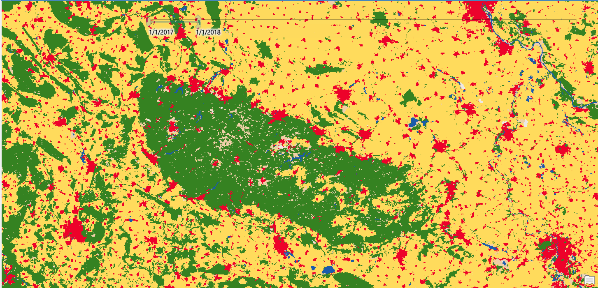
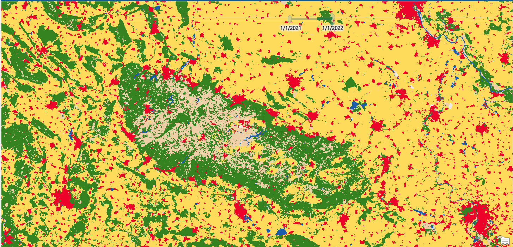
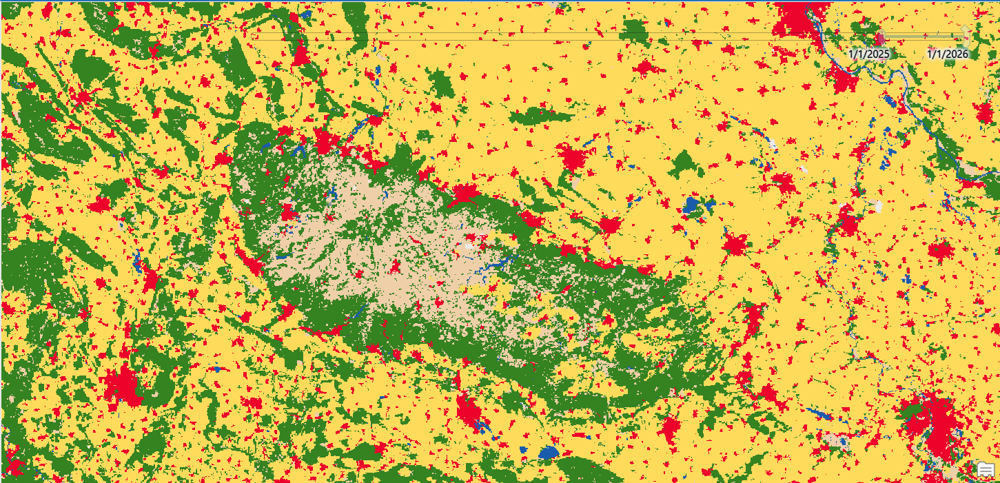

# Harz Deforestation Monitoring (ArcGIS Pro + Sentinel-2)

[English](#english) | [Deutsch](#deutsch)

---

## English

### Overview
Time-series monitoring of bark beetle-driven deforestation in the Harz Mountains, Germany (2017–2025), using Esri/Impact Observatory's Sentinel-2 10m Land Use/Land Cover classification, visualized and analyzed in ArcGIS Pro. The Harz region lost large areas of spruce forest after 2017 due to bark beetle infestations, intensified by climate-driven drought stress.

### Methodology
1. Added the time-aware **Sentinel-2 10m Land Use/Land Cover Time Series** image service (ArcGIS Living Atlas) to a new ArcGIS Pro project.
2. Enabled time filtering and visualized annual land-cover change (2016–2025) over the Harz study area.
3. Exported annual raster snapshots (2017, 2021, 2025) at 50m resolution using **Copy Raster**.
4. Extracted per-class pixel counts from each raster's attribute table and converted to area (km²).

### Results

| Year | Forest cover (Trees class) |
|------|------------------------------|
| 2017 | 7,186 km² |
| 2021 | 5,676 km² |
| 2025 | 5,511 km² |

**Forest cover declined by ~23.3% between 2017 and 2025** across the study extent, consistent with the documented bark beetle outbreak in the region.

### Visual comparison

### Data
Raw pixel-count statistics per year:
- [harz_lulc_2017_stats.csv](harz_lulc_2017_stats.csv)
- [harz_lulc_2021_stats.csv](harz_lulc_2021_stats.csv)
- [harz_lulc_2025_stats.csv](harz_lulc_2025_stats.csv)

### Tools
ArcGIS Pro · ArcGIS Living Atlas (Esri/Impact Observatory Sentinel-2 10m LULC) · Copy Raster · Raster Attribute Tables

### Source
Esri, "The ArcGIS Imagery MOOC: Foundations and Frontiers" (completed September 2026) — adapted exercise, expanded with quantitative area analysis.

---

## Deutsch

### Überblick
Zeitreihenbasierte Überwachung der borkenkäferbedingten Entwaldung im Harz, Deutschland (2017–2025), basierend auf der Sentinel-2 10m Landbedeckungsklassifikation von Esri/Impact Observatory, visualisiert und analysiert in ArcGIS Pro. Der Harz verlor seit 2017 große Fichtenwaldflächen durch Borkenkäferbefall, verstärkt durch klimabedingten Trockenstress.

### Methodik
1. Hinzufügen des zeitbasierten **Sentinel-2 10m Land Use/Land Cover Time Series** Image Service (ArcGIS Living Atlas) zu einem neuen ArcGIS Pro-Projekt.
2. Aktivierung der Zeitfilterung und Visualisierung der jährlichen Landbedeckungsänderung (2016–2025) im Untersuchungsgebiet Harz.
3. Export jährlicher Raster-Schnappschüsse (2017, 2021, 2025) in 50m Auflösung mittels **Copy Raster**.
4. Extraktion der Pixelanzahl je Klasse aus der Attributtabelle und Umrechnung in Fläche (km²).

### Ergebnisse

| Jahr | Waldfläche (Klasse "Trees") |
|------|------------------------------|
| 2017 | 7.186 km² |
| 2021 | 5.676 km² |
| 2025 | 5.511 km² |

**Die Waldfläche ging zwischen 2017 und 2025 um ~23,3 % zurück** – konsistent mit dem dokumentierten Borkenkäferbefall in der Region.

### Visueller Vergleich

### Daten
Rohdaten (Pixelanzahl je Jahr):
- [harz_lulc_2017_stats.csv](harz_lulc_2017_stats.csv)
- [harz_lulc_2021_stats.csv](harz_lulc_2021_stats.csv)
- [harz_lulc_2025_stats.csv](harz_lulc_2025_stats.csv)

### Werkzeuge
ArcGIS Pro · ArcGIS Living Atlas (Esri/Impact Observatory Sentinel-2 10m LULC) · Copy Raster · Raster-Attributtabellen

### Quelle
Esri, "The ArcGIS Imagery MOOC: Foundations and Frontiers" (abgeschlossen September 2026) — angepasste Übung, erweitert um quantitative Flächenanalyse.
